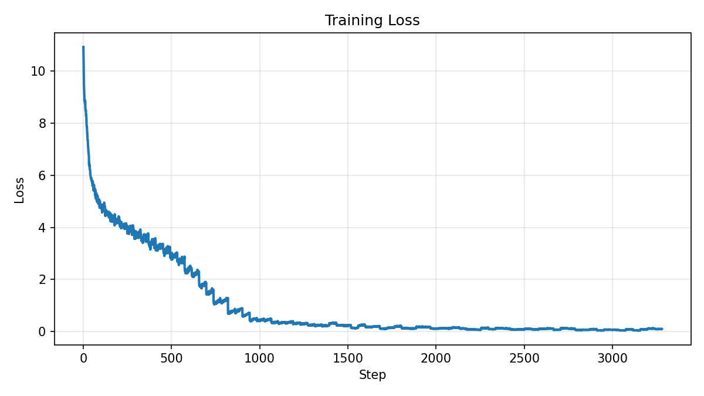

# GPT-2 from scratch in C++/CUDA

A GPT-2 (124M) training stack implemented in C++ and CUDA, with no PyTorch, cuDNN, or other deep-learning framework. The model trains on tiny-shakespeare and generates text; the forward and backward passes, attention, and the optimizer all run on hand-written CUDA kernels, with cuBLAS handling only the dense matrix multiplies.

The project is a study of how GPU training works in practice and where its time is spent. As a correctness check, the entire model also runs on a CPU backend, and its gradients are verified two ways - against that CPU reference and against PyTorch autograd - every tensor matching to within 1e-5.

Generation here is deliberately simple. Fast inference is a separate project, [gpt-inference](https://github.com/Filipeak/gpt-inference): an optimized inference engine for the same model.

## Sample output

The 124M model in this repo, trained on tiny-shakespeare for 80 epochs on a single RTX 3060, continuing a prompt:

```
Prompt:
    GREMIO:
    Ay, and a kind one too:
    Pray God, sir, your wife send you not a worse.

    PETRUCHIO:
    I hope better.

    HORTENSIO:
    Sirrah Biondello, go and entreat my wife
    To come to me forthwith.

Generated:
    PETRUCHIO:
    O, ho! entreat her!
    Nay, then she must needs come.

    HORTENSIO:
    my widow, I will
```

## What's inside

The file each item lives in is noted alongside it.

- **FlashAttention-2, forward and backward, by hand** - warp-tiled online softmax with the log-sum-exp trick, causal masking, bank-conflict-avoiding padded transposed K/Q tiles in shared memory, and one-`atomicAdd`-per-tile `dQ` accumulation in the backward pass. `src/backend/cuda/kernels/attention.cu`
- **Fused LayerNorm + residual** - mean and variance in a single pass with Welford's algorithm and warp-shuffle reductions. `src/backend/cuda/kernels/layernorm.cu`
- **Fused epilogues** - bias + GELU fused after the GEMM, and a fused cross-entropy + softmax backward that emits `(softmax - onehot)/N` directly. `src/backend/cuda/kernels/linear.cu`, `src/backend/cuda/kernels/cross_entropy.cu`
- **Numerically-stable online softmax** over the 50k-token vocabulary, with masking for the padded entries. `src/backend/cuda/kernels/softmax.cu`
- **AdamW** with bias correction and decoupled weight decay, skipped on biases and LayerNorm gains. `src/backend/cuda/kernels/adamw.cu`
- **Device-side gradient-norm clipping** - the global norm is computed on the GPU (cuBLAS `snrm2` in device-pointer mode) and applied without any GPU→CPU round-trip. `src/backend/cuda/kernels/gradient_clip.cu`
- **Full training loop** - gradient accumulation, cosine learning-rate decay with linear warmup, and the GPT-2 initialization scheme (residual projections scaled by `1/sqrt(2·n_layers)`). `src/train/train.cpp`, `src/model/gpt.cpp`
- **Simple autoregressive generation** - temperature / top-k / top-p sampling, re-running the full forward pass for every token (no KV cache); reports time-to-first-token and tokens/sec. `src/infer/infer.cpp`, `src/infer/token_sampler.cpp`
- **A CPU reference backend used as a correctness oracle** - the same model runs on CPU and CUDA behind one interface, and all 16 weight-gradient tensors are checked against both the CPU reference and PyTorch autograd to within `1e-5`. `src/backend/cpu/cpu_backend.cpp`, `src/model/gpt_test.cpp`
- **Debugging and profiling built in** - every op and layer is an NVTX range, a `GPT_DEBUG` build syncs after each op and names the one that failed, and CMake targets run compute-sanitizer and Nsight Systems. `src/backend/profile_range.h`, `src/backend/cuda/core/cuda_backend.cu`, `cmake/tools.cmake`

cuBLAS only handles the dense matrix multiplies (QKV, the attention and FFN projections, the un-embedding); everything else is a hand-written kernel. The elementwise ones - softmax, LayerNorm, AdamW, gradient clipping - use `float4` loads and stores to get more out of memory bandwidth.

## Architecture

All the model code talks to one interface, `IGPTBackend` (`src/backend/backend_interface.h`), with two implementations behind it: a plain **CPU backend** and the **CUDA backend**. `src/model/gpt.cpp` is written against the interface and doesn't know which one it's running on, so the exact same forward and backward pass works on either device. That's what lets the correctness test (below) run both and compare them. Device syncs and profiler ranges go through the same interface, so the model and training code never call CUDA directly.

```
src/
  core/        logging and the host timer
  backend/
    backend_interface.h   IGPTBackend - the op-level abstraction
    profile_range.h       scoped profiler range (NVTX on CUDA, no-op on CPU)
    common/               shared tensor-index helpers
    cpu/                  reference backend (correctness oracle)
    cuda/
      core/               device memory, cuBLAS / cuRAND handles, NVTX and GPT_DEBUG checks
      kernels/            hand-written kernels (attention, layernorm, …)
  model/       GPT forward/backward, weight & activation buffers, gradient test
  train/       training loop, data loader, LR schedule
  infer/       autoregressive generation, token sampler
cmake/         helper targets: Python data and goldens, compute-sanitizer, Nsight Systems
data/          dataset download and tokenizer bridge (Python)
tools/         PyTorch reference model, gradient goldens, PyTorch benchmark (Python)
```

Default model configuration (`src/train/train.cpp`):

| Hyperparameter         | Value                     |
| ---------------------- | ------------------------- |
| Max sequence length    | 256                       |
| Vocabulary size        | 50,257 (padded to 50,304) |
| Transformer layers     | 12                        |
| Attention heads        | 12                        |
| Model dimension        | 768                       |
| Feed-forward dimension | 3,072                     |
| Parameters             | ~124M                     |
| Precision              | fp32                      |

## Build & run

### Prerequisites

- NVIDIA GPU + **CUDA Toolkit 12.x** (it includes compute-sanitizer)
- **CMake >= 3.25** and a **C++17** compiler
- **Python 3** for the dataset and the PyTorch reference: `pip install -r requirements.txt`. CMake uses the first `python` it finds; pick another with `-DPython3_EXECUTABLE=<path>`. A plain build never runs Python.
- Optional: **Nsight Systems** for the `nsys` profiling target

Developed and tested on Windows 10 with MSVC and an RTX 3060 (12 GB). CMake targets the local GPU via `CUDA_ARCHITECTURES native`. The commands below use forward-slash paths and Linux/macOS binary names (`build/src/<tool>/gpt_<tool>`). On Windows the binaries live under a config subfolder with an `.exe` suffix (for example `build\src\train\Release\gpt_train.exe`).

### 1. Configure and build

```bash
cmake -B build
cmake --build build --config Release
```

### 2. Get and tokenize the data

```bash
cmake --build build --target data
```

Downloads tiny-shakespeare to `data/tiny_shakespeare.txt` and tokenizes it with GPT-2's BPE (tiktoken) into `data/tiny_shakespeare.bin`, a flat file of `uint16` token ids. Like every Python target, it reruns only when its output is missing or its script changed.

### 3. Verify the kernels (gradient checks vs CPU and PyTorch)

`prep_grad.py` builds the same tiny model in PyTorch and writes out random weights, input tokens, and PyTorch's autograd gradients. `gpt_test` then loads them, runs the CPU and CUDA backends, and compares the gradients both ways.

```bash
cmake --build build --target grad_goldens
ctest --test-dir build -C Release --output-on-failure
```

Expected: `100% tests passed`. Run `./build/src/model/gpt_test` from the repo root to see the two tables of 16 `[ PASS ]` tensors (CPU vs CUDA, then CUDA vs PyTorch), each ending in `--- 16 passed, 0 failed ---`.

### 4. Train

```bash
./build/src/train/gpt_train \
    --epochs 80 \
    --batch-size 8 \
    --batch-accum-steps 4 \
    --seed 42 \
    --output ./data/gpt_124M.bin \
    --data ./data/tiny_shakespeare.bin
```

Each optimizer step logs the mean loss and the step time, both read after one explicit GPU sync at the end of the step. `--max-steps <n>` stops after `n` optimizer steps (the learning-rate schedule still follows the full run), and without `--output` the trained weights are not saved.

### 5. Generate

The tokenizer is Python (tiktoken), so the prompt goes in and the result comes out as token files. Put the prompt in `res/prompt.txt`, then:

```bash
python data/tokenizer.py encode-file res/prompt.txt res/prompt.bin
./build/src/infer/gpt_infer \
    --model ./data/gpt_124M.bin \
    --input ./res/prompt.bin \
    --output ./res/output.bin \
    --max-tokens 40 \
    --temperature 1.0 \
    --top-k 50 \
    --top-p 0.9 \
    --seed 42
python data/tokenizer.py decode-file res/output.bin res/output.txt
cat res/output.txt
```

`res/output.txt` holds the prompt followed by the generated text. The prompt plus generated tokens must fit in the 256-token context, and `--verbose` prints per-step timings.

## Debugging and profiling

**`GPT_DEBUG`** - a build option that syncs after every op and checks for CUDA errors, reporting them against the op and its place in the model.

```bash
cmake -B build -DGPT_DEBUG=ON
```

With a bad pointer planted in the GELU backward kernel, it stops with:

```
[error] CUDA error in micro_step > backward > layer_11 > gelu_bwd: an illegal memory access was encountered
```

A normal build reports the same fault at whichever call syncs next - here the upload of the next batch, in `cuda_memory.cu`. Every build checks for launch errors after each kernel; `GPT_DEBUG` builds are slow and their timings are not representative.

**`sanitize`** - runs `gpt_test` under compute-sanitizer's `memcheck`, `racecheck`, `initcheck` and `synccheck`, and fails on the first tool that reports a problem. It found a shared-memory race in the FlashAttention forward kernel, since fixed. It only exercises the tiny test model.

```bash
cmake --build build --config Release --target sanitize
```

**`nsys`** - profiles three training steps with Nsight Systems and prints the GPU time spent under each NVTX range and in each kernel. Every backend op, layer, forward and backward pass is a named range, so the summary reads as a per-op breakdown. CUDA code is always built with `-lineinfo`, so compute-sanitizer and Nsight Compute can point at source lines.

```bash
cmake --build build --config Release --target nsys
```

The largest ranges, as GPU time per micro-step (batch 8 x 256 tokens, averaged over the 12 micro-steps profiled):

| NVTX range                               | GPU time | Share of the micro-step |
| ---------------------------------------- | -------- | ----------------------- |
| `micro_step` (forward + loss + backward) | 210 ms   | 100%                    |
| `backward`                               | 137 ms   | 65%                     |
| `forward`                                | 73 ms    | 35%                     |
| `linear_bwd` (48 calls)                  | 63 ms    | 30%                     |
| `flash_attention_bwd` (12 calls)         | 41 ms    | 20%                     |
| `linear_fwd` (48 calls)                  | 34 ms    | 16%                     |
| `unembedding_bwd`                        | 25 ms    | 12%                     |
| `flash_attention_fwd` (12 calls)         | 18 ms    | 8%                      |
| `unembedding_fwd`                        | 12 ms    | 6%                      |

The optimizer update (`update`: gradient clipping, AdamW, zeroing the gradients) adds about 22 ms once per optimizer step.

## Benchmarks

**Setup:** RTX 3060 12 GB, 124M config, batch 8 x sequence 256 = 2,048 tokens, fp32 weights with TF32 matmuls on both sides. This repo runs `gpt_train --batch-accum-steps 1`, so like the PyTorch loop in `tools/benchmark.py` it runs AdamW after every batch. All numbers are medians of steady-state steps.

| Implementation                | Forward + backward | Full step (+ AdamW) | Tokens/sec (full step) |
| ----------------------------- | ------------------ | ------------------- | ---------------------- |
| This repo (hand-written CUDA) | ~206 ms            | ~229 ms             | ~8,900                 |
| PyTorch 2.9 eager             | ~226 ms            | ~258 ms             | ~7,900                 |
| PyTorch 2.9 + `torch.compile` | ~184 ms            | ~213 ms             | ~9,600                 |

**Forward + backward** compares the model's kernels alone: the forward pass, the loss and the backward pass. Here the hand-written kernels are about 9% faster than eager PyTorch and about 12% slower than `torch.compile`. For this repo it is the GPU time of the `micro_step` range from the `nsys` target (a wall-clock timing of the same span agreed within 1 ms); for PyTorch it is wall-clock time between two syncs.

**Full step** adds the optimizer update and is wall-clock time between syncs on both sides. This repo's step does a little more work than the PyTorch loop: it clips the gradient norm (about 4.6 ms), and it clears the gradients with memsets (about 7 ms) where PyTorch just drops them with `zero_grad(set_to_none=True)`. Repeated runs of the full step spread by about ±5% for this repo and eager PyTorch, so those numbers are approximate.

With the training command from step 4 (`--batch-accum-steps 4`), the update runs once per four batches, so `gpt_train` logs about 9,700 tokens/s: 4 x 206 ms + 22 ms of update per 8,192 tokens.

`torch.compile` needs Triton, which on Windows means the `triton-windows` package and Python 3.13 or older - PyTorch refuses to compile on 3.14. The numbers above come from a clean Python 3.13 venv with `torch==2.9.1` (CUDA 12.6 build) and `triton-windows<3.6`, running `python tools/benchmark.py --compile`.

## Correctness

Two gradient checks guard the backward pass. `tools/prep_grad.py` builds the same small model in PyTorch, runs one forward and backward, and writes out the weights, the input tokens, and PyTorch's autograd gradients. `gpt_test` loads those, runs its own forward and backward on both the CPU and CUDA backends, and compares every weight-gradient tensor element by element - each must agree to within `1e-5` (`src/model/gpt_test.cpp`, `tools/prep_grad.py`).

**CPU vs CUDA** - confirms the two backends implement the same math (this catches CUDA implementation bugs: races, indexing, reductions).

```
-- weight gradient (CPU vs CUDA) comparison (eps=1.0e-05) --
[ PASS ] wte            size=16224     max_diff=5.588e-08      rel_diff=0.000%
[ PASS ] wpe            size=2048      max_diff=5.588e-08      rel_diff=0.000%
[ PASS ] ln_1_w         size=128       max_diff=2.049e-08      rel_diff=0.000%
[ PASS ] ln_1_b         size=128       max_diff=1.583e-08      rel_diff=0.000%
[ PASS ] qkv_proj_w     size=12288     max_diff=1.397e-09      rel_diff=0.001%
[ PASS ] qkv_proj_b     size=384       max_diff=9.313e-09      rel_diff=0.000%
[ PASS ] attn_proj_w    size=4096      max_diff=1.211e-08      rel_diff=0.000%
[ PASS ] attn_proj_b    size=128       max_diff=1.601e-10      rel_diff=0.000%
[ PASS ] ln_2_w         size=128       max_diff=9.686e-08      rel_diff=0.000%
[ PASS ] ln_2_b         size=128       max_diff=8.941e-08      rel_diff=0.000%
[ PASS ] ffn_up_w       size=32768     max_diff=2.619e-09      rel_diff=0.001%
[ PASS ] ffn_up_b       size=1024      max_diff=6.985e-09      rel_diff=0.000%
[ PASS ] ffn_down_w     size=32768     max_diff=5.821e-09      rel_diff=0.000%
[ PASS ] ffn_down_b     size=128       max_diff=1.601e-10      rel_diff=0.000%
[ PASS ] ln_f_w         size=32        max_diff=1.019e-10      rel_diff=0.000%
[ PASS ] ln_f_b         size=32        max_diff=8.196e-08      rel_diff=0.000%
--- 16 passed, 0 failed ---
```

**CUDA vs PyTorch** - confirms the hand-derived backward is correct against an independent autograd reference (this catches errors in the derivation itself).

```
-- weight gradient (CUDA vs PyTorch) comparison (eps=1.0e-05) --
[ PASS ] wte            size=16224     max_diff=1.863e-08      rel_diff=0.000%
[ PASS ] wpe            size=2048      max_diff=1.863e-08      rel_diff=0.000%
[ PASS ] ln_1_w         size=128       max_diff=1.676e-08      rel_diff=0.000%
[ PASS ] ln_1_b         size=128       max_diff=6.519e-09      rel_diff=0.000%
[ PASS ] qkv_proj_w     size=12288     max_diff=8.731e-10      rel_diff=0.000%
[ PASS ] qkv_proj_b     size=384       max_diff=7.451e-09      rel_diff=0.000%
[ PASS ] attn_proj_w    size=4096      max_diff=8.848e-09      rel_diff=0.001%
[ PASS ] attn_proj_b    size=128       max_diff=1.164e-10      rel_diff=0.000%
[ PASS ] ln_2_w         size=128       max_diff=7.078e-08      rel_diff=0.000%
[ PASS ] ln_2_b         size=128       max_diff=5.588e-08      rel_diff=0.000%
[ PASS ] ffn_up_w       size=32768     max_diff=2.095e-09      rel_diff=0.000%
[ PASS ] ffn_up_b       size=1024      max_diff=4.657e-09      rel_diff=0.000%
[ PASS ] ffn_down_w     size=32768     max_diff=3.260e-09      rel_diff=0.000%
[ PASS ] ffn_down_b     size=128       max_diff=1.237e-10      rel_diff=0.000%
[ PASS ] ln_f_w         size=32        max_diff=6.548e-11      rel_diff=0.000%
[ PASS ] ln_f_b         size=32        max_diff=5.215e-08      rel_diff=0.000%
--- 16 passed, 0 failed ---
```

The CUDA-vs-PyTorch check is the important one: the CPU and CUDA backends share the same hand-derived formulas, so only an independent reference like autograd can confirm the derivation itself - above all the FlashAttention and LayerNorm backward passes, the easiest to get subtly wrong. Here they agree to about 1e-8, far inside the 1e-5 bar.

## Training loss




**Note:** Training loss over ~3,300 steps (80 epochs on tiny-shakespeare). It falls from about 11 to near zero, which is textbook overfitting: a 124M-parameter model has far more capacity than a ~340k-token corpus needs, so it memorizes the training text rather than learning to generalize. That is expected here and not a problem - the goal of the project is the CUDA and systems work, not a model that generalizes, and cleanly fitting a small corpus is enough to exercise the whole training and inference path.

## Roadmap

Concrete next steps, in rough priority order:

- **Mixed precision (fp16 / bf16) with tensor cores** (WMMA/MMA) - the kernels are fp32 today; this is the headline performance step.
- **A faster FlashAttention backward** - it is the single most expensive kernel in a training step (about a fifth of the GPU time, see the `nsys` table above), ahead of every cuBLAS GEMM kernel.
- **Double-buffered async shared-memory loads** (`cp.async`) and vectorized loads in the attention kernels.
- **Multi-tensor-apply AdamW** to cut optimizer launch overhead.
- **Self-describing checkpoints** that carry the model config, not just raw weights.

## References

- Dao et al., *FlashAttention: Fast and Memory-Efficient Exact Attention with IO-Awareness* (2022) - [arXiv:2205.14135](https://arxiv.org/abs/2205.14135)
- Dao, *FlashAttention-2: Faster Attention with Better Parallelism and Work Partitioning* (2023) - [arXiv:2307.08691](https://arxiv.org/abs/2307.08691)
- Radford et al., *Language Models are Unsupervised Multitask Learners* (GPT-2, 2019)
- Karpathy, [`llm.c`](https://github.com/karpathy/llm.c) - reference for tensor allocation and the AdamW update
- Tiny-shakespeare dataset, from Karpathy's [`char-rnn`](https://github.com/karpathy/char-rnn)
- ["Online Softmax to FlashAttention"](https://medium.com/data-science-collective/online-softmax-to-flash-attention-and-why-it-matters-9d676e7c50a8) - helpful derivation walkthrough
- ["GPT-2 Detailed Model Architecture"](https://medium.com/@hsinhungw/gpt-2-detailed-model-architecture-6b1aad33d16b) - a clear diagram of the 124M model

## License

Released under the MIT License. See [LICENSE](LICENSE).
